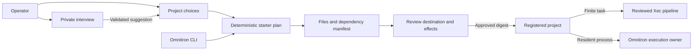

# Agent Studio

A Studio team owns a chat, its task history and shared notes in one project or planning workspace. Choose the lead model, add members from connected local adapters and address work to a person in the roster. The lead collects results across adapters. An operator can review a result or open a proposed automation in the flow editor.

## Start a team

1. Run `omnitron studio doctor` on the controller to see which installed adapters can accept a turn and which support the room's MCP tools. Open **Agent Studio → New team**, select a lead with room tools and choose its model.
2. Name the room and set the allowed providers, maximum active members, per-request delegation limit and cost tier. The first operator message starts model work. Opening an empty team has no inference cost.
3. Add a member with its own name, adapter, model and responsibility, or let the lead call `team_catalog`, `team_invite` and `team_assign`. For automatic selection each connector supplies qualified capability and cost data. Within the approved budget the controller picks a compatible model using comparable quotes or declared tiers.
4. Use **Chat** to address the lead or a named member. **Tasks** follows dispatched assignments. In **Memory**, named notes carry an author and revision. An outdated edit asks the writer to reread the current entry.
5. Ask the lead to propose a flow. Choose **Open in flow editor** to preview an event in the room's workspace. To share the original graph, choose **Submit for administrator review** and confirm the project and stack. Copy the review link from the receipt. An administrator opens the shared draft from the link or from **Flows** and reviews it before activation. [Event flows](./FLOWS.md)

Two connected providers can work simultaneously. A connector can opt into up to eight concurrent provider turns with `--jobs`. Studio serializes work for each individual member's provider conversation. Workers return their own results. After the lead and its assigned workers finish, the controller queues one synthesis for that delegation group, including incomplete outcomes. A retired member's prior work remains in the journal.

The connector owns its subscription. A provider receives the addressed task, instructions and any room material that the authorized member reads or shares. Room tools can read explicitly shared turns, notes and proposals. Provider conversation identifiers, workspace credentials and the local operator's session stay within their authentication boundaries. When an individual conversation becomes a team, its lead starts a fresh provider session. The operator retains the original private journal. Team members can read the new shared turns and notes.

| Adapter | Available participation |
| --- | --- |
| Codex | Member or lead when the installed CLI exposes the isolated room MCP toolset. |
| Claude Code | Member or lead with a signed-in supported restricted CLI. Check the installed profile with `studio doctor`. |
| Antigravity | Member through strict headless execution. Completed answers feed back to the lead. |
| Kimi | The doctor reports local availability. Execution requires a qualified adapter that isolates the room's tools. |

Read the journal after a dropped connection. A claimed turn with an unknown provider outcome remains interrupted. Cancelling a request closes outstanding descendants. A model with an uncertain conversation receives a fresh provider context on its next team turn. A connector rechecks operator authority before dispatch and before accepting output.

## Coordination choices

T3 Code separates the application thread from provider sessions and keeps execution on the workspace host. Studio uses a room identity, member identity and a separate provider continuation for each member. Claude Code teams and the OpenAI Agents SDK distinguish conversation ownership from delivery of delegated results. In Studio the lead stays identifiable across all adapters. [T3 Code architecture](https://github.com/pingdotgg/t3code/blob/main/docs/internals/overview.md) · [T3 Code V2 lifecycle design](https://github.com/pingdotgg/t3code/blob/main/docs/orchestration-v2/feature-lifecycles.md) · [Claude Code teams](https://code.claude.com/docs/en/agent-teams) · [OpenAI agent orchestration](https://openai.github.io/openai-agents-python/multi_agent/)

AutoGen documents explicit group termination. Google ADK and CrewAI describe role-based orchestration. Studio makes role eligibility, provider access and the limit on delegation enforceable in the controller. A cheaper model needs declared qualifications, and a team message uses part of the same dispatch budget as an assignment. [AutoGen selector teams](https://microsoft.github.io/autogen/stable/user-guide/agentchat-user-guide/selector-group-chat.html) · [ADK multi-agent systems](https://google.github.io/adk-docs/agents/multi-agents/) · [CrewAI crews](https://docs.crewai.com/en/concepts/crews)

MCP serves the tools of a single active turn. ACP and A2A distinguish protocol capabilities, sessions and tasks. A connector advertising a model and a connector able to isolate room tools are distinct observations. The controller verifies the selected capability before starting the lead. [MCP lifecycle](https://modelcontextprotocol.io/specification/2025-11-25/basic/lifecycle) · [ACP initialization](https://agentclientprotocol.com/protocol/v1/initialization) · [A2A specification](https://a2a-protocol.org/latest/specification/)

## Plan a first project

1. Open **Workspace → Agent Studio** with an operator or administrator account. In the system workspace, the conversation belongs to project planning.
2. Pick a provider. Run the connection command shown in the Console in a terminal on the daemon host, as the account that owns the subscription. Leave the terminal open while using the adapter.
3. Choose **Plan a project** and describe a concrete job in your own words. Studio assigns an analyst to ask about missing requirements. The daemon supplies the interview instructions. Your draft contains only your own message.
4. Once the requirements are clear, review the proposed choices. **Review project starter** opens the project form with those choices. Adjust any of them, set the name and inspect the full file contents, effects, dependencies and destination.
5. An administrator can confirm **Create project** against the reviewed digest. The server checks the review again, creates the files under its workspace and registers the project. The same form works directly from **Projects**.

| Example requirement | Minimal composition | What the starter runs |
| --- | --- | --- |
| Check a group of scripts on demand | Xec | A repeatable local task |
| Record observations in an embedded database and inspect them later | Kysera with SQLite | A standalone data command |
| Run a repeatable task and retain its result | Xec and Kysera with the selected driver | The task runs the data command |
| Keep one process available under supervision | Node worker | A process in the project's `dev` stack |
| Run a Titan application, automate checks and persist observations | Titan, Xec and Kysera | A supervised application and two independently invocable commands |

SQL projects select one driver for SQLite, PostgreSQL or MySQL. Xec and Kysera command projects have no resident worker. On the command line, `omnitron init --name weekly-report --automation --database sqlite --service none` produces the same reviewed composition. The generated README describes installation and the commands, including which operation creates a table or writes an event.

## How project composition works

The catalog answers three independent questions about the requested workload. Xec owns execution and cancellation for a repeatable task. Kysera owns data access through a Kysely executor and one chosen database driver. Omnitron owns supervision when a process has a lifetime to manage. A supervised process can use Node directly or use Titan's application lifecycle. Selecting all three capabilities composes the same components used by each smaller project.



The interview and the form use the same option catalog. The model can ask questions and propose choices. The server independently derives filenames, code, dependencies, effects and the digest from the selected choices. The browser submits the name, choices and digest for creation. A change in content, name, destination or workspace identity requires a new review. CLI initialization runs the same generator in the operator's current directory.

For a tenant-isolated report service, storing a report and enforcing isolation on every query are separate requirements. The current SQL starter demonstrates persistence. Tenant policies require their own implementation and tests. The interview explains the gap and asks whether the operator wants this partial starter. An explicitly required database engine or machine stays part of the review.

### Extending the catalog

Each additional capability needs a concrete user question, an owning subsystem, declared effects and a verification path through its normal entry point. Add independent choices when users genuinely need them. Couple choices only where a technical dependency requires it.

| Workload requirement | Owning mechanism | Evidence required before offering the choice |
| --- | --- | --- |
| Evolve a populated schema | Kysera migrations and the selected dialect | Apply to a populated disposable database, interrupt and resume, verify schema and retained records. Expose the recovery policy for destructive changes. |
| Isolate records for different tenants | Kysera executor with application policies, optionally native PostgreSQL RLS | Exercise each allowed operation and verify refusal across two tenant identities, including transactions and bulk writes. |
| Run on another machine or in a container | An explicitly selected Xec target | Check target identity and access, cancellation and cleanup on that target. Bind destination and effects to the operator's review. |
| Serve requests from several components | Titan lifecycle and Netron contracts | Exercise the public client and server path, readiness, disconnect, recovery and authorization for the proposed operation. |
| Change an established project | Its registered path and declared application or task | Show the current revision, proposed files, conflicts, and checks against the project's own entry point. Preserve unrelated local edits. |

These rows define admission criteria for future options. The current starter provisions the capabilities listed in the example table above. Integrating another package also requires testing projects that omit it, so an expanded catalog keeps smaller projects independently usable.

## Work on an existing project

Choose a registered project in the Console. Select a stack to bind a new conversation to it. Open **Connection details** and run the copied command from that project's registered directory. Each connection serves one provider, Console account and workspace. For example:

```sh
omnitron studio connect reports --account ACCOUNT_ID --provider agy
```

Before the first project exists, use `omnitron studio connect --planning --account ACCOUNT_ID --provider codex`. If several CLI installations exist, select the executable with `--binary /absolute/path/to/codex`. Use `omnitron studio doctor --provider codex` to check discovery through the selected installation.

Use **Attach text** to read a small UTF-8 file into the editable message. Inspect or remove any part before sending. The message limit is 32 KiB. The adapter starts the provider in a private temporary working directory and passes the selected model, role instructions, explicit message and provider conversation identifier. The provider handles its own authentication and can identify its subscriber. The local Console account ID, registered project path and filename stay in Omnitron unless included in the message itself.

## Assign and review work

| Responsibility | Expected result |
| --- | --- |
| Analyst | Findings, uncertainties and a proposal |
| Engineer | Proposed implementation and validation |
| Reviewer | Findings with evidence |
| Operator | An operational runbook with checks and recovery |

Select a model explicitly or use **Automatic · budgeted** with a maximum cost tier. The connector reads the models its installed CLI actually offers. For automatic routing, use `--model-policy /path/to/policy.json` to declare the task classes and cost limits you have qualified for those models. This sample uses an illustrative ID that must be replaced with a listed ID.

```json
[
  {
    "id": "your-listed-model-id",
    "classes": ["general", "reasoning"],
    "costTier": "economy",
    "qualityTier": "standard"
  }
]
```

Models with unknown costs stay available for explicit selection. Automatic routing filters by task requirements, then orders eligible models by comparable quotes or approved cost tiers. Model families and display names carry no implicit cost or ability. The thread records the selection. A change of model or a cost increase requires a fresh decision. Each completed turn displays the input and output token counts supplied by the provider. A missing count is shown as a dash.

The local ledger retains the request, response, outcome, reported usage and operator review. An operator can choose **Accept result** or **Request changes** and record the reasoning. Project creation, applying changes and deploying processes use the authority and review rules of their owning Omnitron operation.

## Recover an interrupted conversation

The daemon admits each turn by a stable request ID and rechecks the sending user's session before dispatch. A connector defaults to one active turn and has capacity for 16 queued and running turns. **Stop turn** cancels queued or running work. Losing the connector marks in-flight work interrupted and preserves the last recorded response. After a lost acknowledgment, **Retry same request** uses the original ID. **Withdraw request** cancels an admitted turn or records a withdrawal that also applies if the original request arrives later. A completed result remains available. In an individual conversation, start a fresh conversation after an unknown provider outcome. A team retains its member and journal while starting a fresh provider context for the next assignment.

## Verification

The integration tests exercise the private Netron socket, SQLite ledger, local Xec executor and installed provider under a synthetic account. The optional subscription test uses four synthetic turns per configured provider. It checks conversation continuity, a clarifying question and the concrete manifest produced after the operator answers. Select an executable with `OMNITRON_STUDIO_LIVE_CODEX` or `OMNITRON_STUDIO_LIVE_AGY`, and a listed model with the corresponding `OMNITRON_STUDIO_MODEL_CODEX` or `OMNITRON_STUDIO_MODEL_AGY`. From the Omnitron application package run `pnpm exec vitest run test/integration/studio-subscription.test.ts`.
