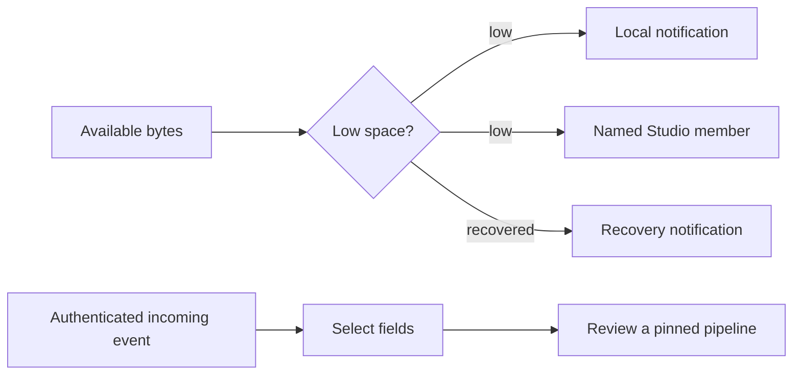

# Event flows

A flow tells a controller what to observe, which data to keep and what to do when a condition changes. Open **Flows** in the system or a project workspace. A human can assemble the graph in the editor. A Studio lead can propose the same document in a team room. Opening that proposal carries its project and stack into the editor.

## Build a disk monitor

1. Start from the **Disk space** template. Set the absolute path of a mounted volume on the controller. Free space means bytes available to the service account.
2. Set the lower and recovery thresholds. For a 10 GiB warning and 12 GiB recovery, enter `10737418240` and `12884901888` bytes. Choose the sampling interval.
3. Follow the **low** and **recovered** ports to their notifications. Add other actions to the appropriate branch. The sample event and its highlighted path let you inspect what each action would receive.
4. Save the definition. An administrator activates the reviewed revision in its workspace. Open its event history to follow the observation, traversed connections and delivery receipts.

| Free space | Previous condition | Result |
| --- | --- | --- |
| 10 GiB | Healthy | Continue sampling |
| 9 GiB | Healthy | Open the incident and notify once |
| 8 GiB, then 11 GiB | Low | Keep the incident open |
| 12 GiB | Low | Record recovery and rearm |
| 9 GiB | Healthy again | Open a new incident |

An unreadable volume produces a source error. The last known condition remains available. A controller restart resumes the active revision and persisted condition. A new activation begins a new observation period.



## Choose the effect

| Output | What the controller does |
| --- | --- |
| Local notification | Records the notification as a local flow delivery. It can be inspected with the triggering event. |
| Request pipeline review | Prepares the specified pipeline revision. An administrator can inspect and start the resulting run. |
| Run approved release pipeline | Starts the pinned, local release-only pipeline for the reviewed project and stack. Event fields never become command parameters. |
| Assign a Studio task | Sends the configured assignment to the selected team member through the ordinary Studio queue. The resulting turn identifies the work. |

A project-scoped pipeline review looks up the selected definition by ID in the current project and stack, including registered stack aliases. If its target or revision changed, the operator can inspect the recorded delivery before choosing another revision.

A disk cleanup can be a published project maintenance task. Review its allowed cache roots, inventory, retention limits and recovery before attaching the release pipeline. The stock disk template only records notifications. A Studio task is suitable when an unusual volume change needs investigation before anyone changes files. External actions use the activating administrator's current authority. Loss of authority leaves a delivery available for review.

## Share one graph

Studio offers `flow_catalog`, `flow_preview` and `flow_propose`. The editor and the authenticated `OmnitronFlows` service use the controller's registry and validator. The room owner can open a proposal for a private preview or choose **Submit for administrator review** to share its graph with administrators of this controller. The project and stack shown in the confirmation determine where the draft appears and where actions may run. Review the node parameters and output text before sharing them.

`OmnitronFlows.submitProposal({ project, threadId, proposalId })` copies the selected proposal into an inactive draft in that workspace. The receipt contains the shared flow ID, workspace and original revision. Submitting the same proposal again returns that receipt across controller restarts and subsequent administrator edits. Conversation history, team memory, provider sessions and operator grants stay in Studio.

An administrator opens the draft from **Flows**, checks its submitting account and revision, and previews the graph. The administrator can edit and save it before activating a reviewed revision under their own account.

An event has an idempotency key, a graph source, an event type and bounded named scalar fields. One source can fan out to several destinations. Each destination has one input. Graphs are acyclic. `data.select@1` specifies the fields to forward. Incoming events use authenticated Netron submission for a configured input. File paths and provider credentials belong to the node that owns them.

The controller commits the event receipt, next condition and intended deliveries together. An external delivery has its own durable ID. Recovery checks the receiving service with that ID. A component revision change requires review before an active flow can use the new behavior.

**Flows** lists names and status across a project or within a selected stack. Its Netron `list` method returns a bounded page and a continuation cursor. Opening a saved link fetches that one definition, its active revision and its source health using `get`. A project link can resolve a flow in any of its stacks. Changes always name the flow's exact workspace.

## Extend the palette

For reusable controls on a running distribution, place a JSON component pack at `$OMNITRON_HOME/flow-components.json`. The controller reads it on startup. On POSIX the service user owns the regular file and group and other users must lack write access. Each pack can provide up to 64 versioned components. It composes built-in transformations and an optional final decision. Its branches, field labels and constraints appear in the editor and in the Studio catalog.

```json
{
  "version": 1,
  "components": [{
    "type": "operations.disk-reserve@1",
    "label": "Disk reserve",
    "fields": [
      { "key": "floor", "label": "Enter below (bytes)", "type": "number", "min": 0 },
      { "key": "recovery", "label": "Recover at (bytes)", "type": "number", "min": 0 }
    ],
    "steps": [
      { "type": "data.select@1", "config": { "fields": ["freeBytes"] } },
      { "type": "logic.threshold@1", "config": { "field": "freeBytes" },
        "bind": { "below": "floor", "rearmAt": "recovery" } }
    ]
  }]
}
```

A graph using this component exposes the `low` and `recovered` ports. Its revision includes the component fingerprint. An invalid pack produces a visible library diagnostic. Programs using that pack require a valid matching version. The controller continues serving built-in components.

Custom hosts can register typed components with `FlowRegistry` from `@omnitron-dev/omnitron/flows`. Register the component in the controller, then pass that registry to `compileFlow` for repeated evaluation of a revision, or to `evaluateFlow` for one preview. A program carries names, parameters and connections. Trusted code and I/O drivers belong to the host. Integrate a new external input through the existing authenticated event source or provide a controller-owned source driver.

## Read a disk across the mesh

Use **Enrolled node** to monitor an exact mount on a registered peer. The same node registry and authenticated Netron reader power **Fleet**. A reviewed revision pins the peer ID, endpoint and trusted SSH host key. The controller admits the peer's reading to its own journal with its node ID, mount and measurement time. A missing mount, stale snapshot, lost connection or replaced peer is a source error. The controller keeps the last decision and samples again on schedule. Re-enrolling the target requires reviewing a new revision.

**Sampling interrupted** records the first failed observation or the first missed deadline when the controller wakes after a skipped interval. Repeated failures share one interruption. **Sampling resumed** marks the next valid sample. These entries carry the reviewed source and activation and remain in history after a restart or pause. Threshold decisions during the gap are unknown. A fresh reading drives the next decision. If a maintenance task must continue while its network link is down, activate its local monitor on the controller that owns the volume and release.

Machine-local outputs run under the authority of the controller hosting the flow. For lifecycle broadcasts the source is live. The controller reports overload before admission. For a submitted event the durable guarantee starts when the controller commits the input, branch state and delivery IDs.

## Design references

Node-RED's message ports and subflows make connections understandable in the editor. n8n distinguishes triggers from actions and supports human review before a tool acts. Omnitron applies both ideas to the same project-scoped definition and puts effect authority in the receiving service. [Node-RED concepts](https://nodered.org/docs/user-guide/concepts) · [n8n nodes](https://docs.n8n.io/workflows/components/nodes/) · [n8n approvals](https://docs.n8n.io/advanced-ai/human-in-the-loop-tools/)

Flowise exposes state and explicit branches in its graph. LangGraph records checkpoints, while Temporal documents why retrying an activity can repeat an external effect. In Omnitron the threshold state, event key and delivery identity answer three different recovery questions. The history shows all three. [Flowise Agentflow](https://docs.flowiseai.com/using-flowise/agentflowv2) · [LangGraph persistence](https://docs.langchain.com/oss/python/langgraph/persistence) · [Temporal activities](https://docs.temporal.io/activity-definition)
