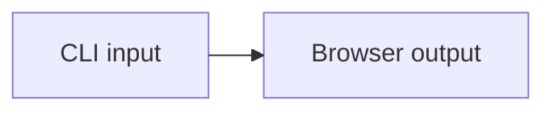

# Native CLI document

:::filetree{title="sample/"}
- `src/` — application source
  - `fileTreeSearchToken.ts` — entry point
  - `modules/`
    - `users.module.ts` — feature module
- `empty/` — reserved directory
- `package.json` — dependencies
:::
