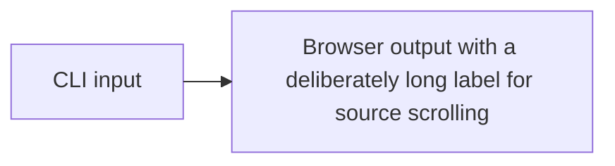

# Native CLI document



:::filetree{title="sample/"}
- `src/` — application source
  - `fileTreeSearchToken.ts` — entry point
  - `modules/`
    - `users.module.ts` — feature module
- `empty/` — reserved directory
- `package.json` — dependencies
:::

```typescript
const document = { title: 'A deliberately long code line for native horizontal scrolling', source: 'ordinary CLI build' };
```

| Source | Result |
| --- | --- |
| Ordinary Markdown table | Native overflow retains its scrollbar policy |

:::tabs{label="Installation command" syncKey="manager"}
:::tab{label="pnpm" value="pnpm"}
First install command.
:::
:::tab{label="npm" value="npm"}
### Install with npm {#npm-installation}

Second install command.
:::
:::

:::tabs{label="Preview command" syncKey="manager"}
:::tab{label="pnpm" value="pnpm"}
First preview command.
:::
:::tab{label="npm" value="npm"}
Second preview command.
:::
:::
